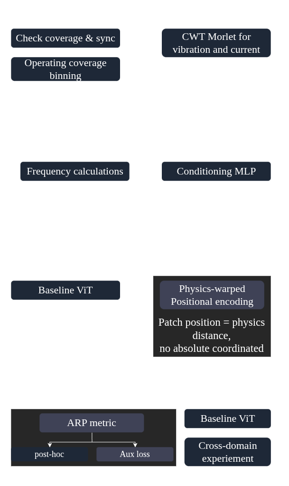
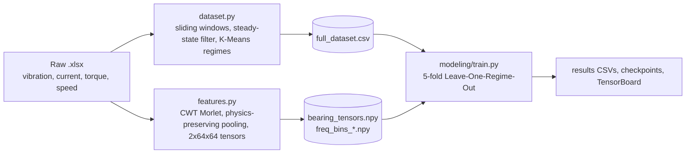
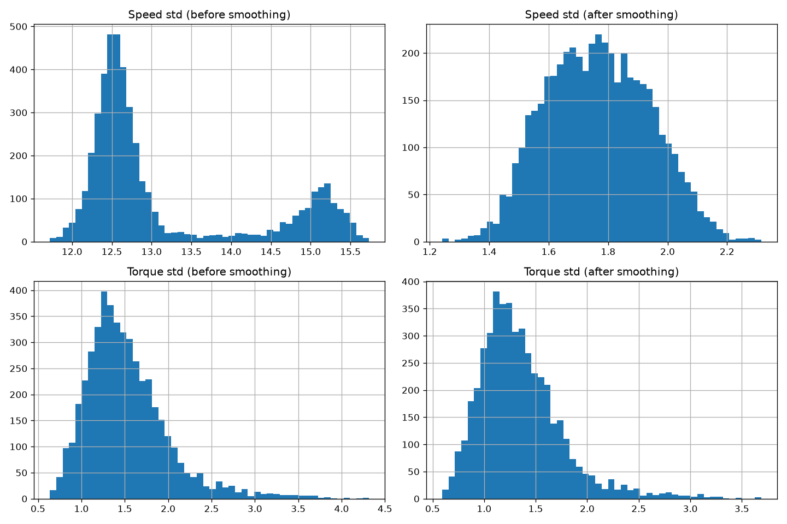
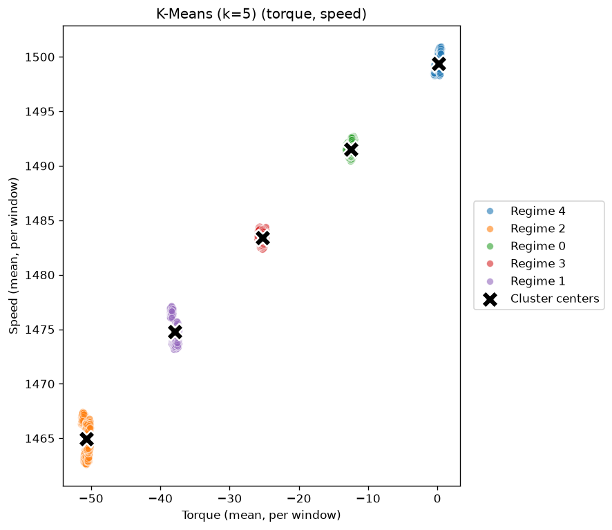
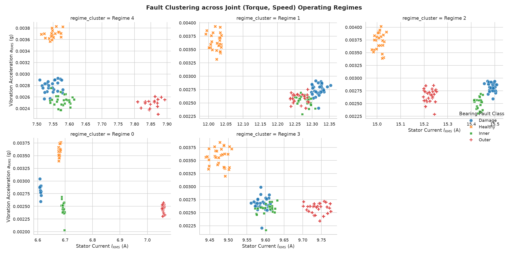
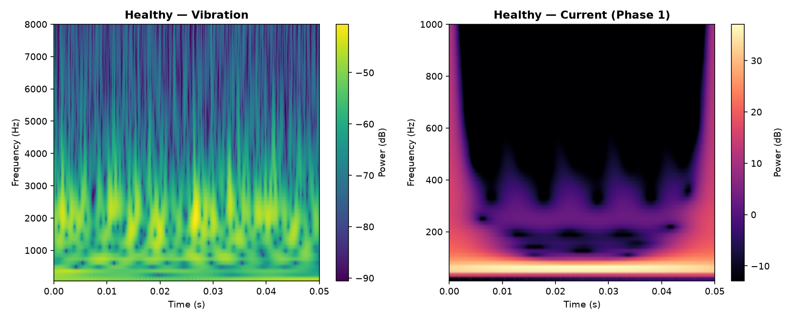

# Bearing Fault Diagnosis from Vibration and Current Scalograms

<a target="_blank" href="https://cookiecutter-data-science.drivendata.org/">
    
</a>

Fault diagnosis for induction-motor bearings from **Continuous Wavelet Transform (CWT Morlet) scalograms of vibration and motor current**, stacked as a 2-channel tensor and classified with a 2D Residual CNN and Vision Transformers. The project investigates how well time-frequency representations generalize to **unseen operating conditions (loads)** under a Leave-One-Regime-Out (LORO) protocol, and builds toward a Vision Transformer with **Physics-Warped Positional Encoding (PWPE)** based on the harmonic distance of each frequency row to the bearing's characteristic fault frequencies ($\text{BPFO}$, $\text{BPFI}$, $\text{BSF}$, $\text{FTF}$) alongside operating-condition modulation.

> **Status:** Data preprocessing, regime clustering, CWT tensor extraction, and three baseline architectures (`cnn`, `vit`, and `cross_attention`) are implemented and evaluated across multiple seeds and dB floor configurations. Note that the active `modeling/train.py` script in the codebase represents the initial training version, while the full LORO CLI with per-channel dB floor scaling, Mixup, and channel-swap ablation is stored in `modeling/train1.txt` (used to generate the results in `reports/results/`). The **Physics-Warped Positional Encoding (PWPE) ViT** and bottleneck FiLM conditioning are the final research goal and are **not implemented yet**.

This is a fault *diagnosis* (condition monitoring) pipeline: it classifies the current health state of the bearing rather than estimating remaining useful life (RUL), serving as a diagnostic building block for predictive maintenance.



---

## Data

The raw data is **not included in the repository** (`/data/` is git-ignored). It consists of 20 Excel workbooks—**one 3 s recording sampled at $20\text{ kHz}$ ($60\,000$ samples) for each combination of 4 bearing health states and 5 nominal load levels**:

```
data/raw/
├── Healthy/  Healthy_0.xlsx  Healthy_25.xlsx  Healthy_50.xlsx  Healthy_75.xlsx  Healthy_100.xlsx
├── Inner/    Inner_0.xlsx    ...
├── Outer/    Outer_0.xlsx    ...
└── Damage/   Damage_0.xlsx   ...
```

The number in each filename indicates the nominal load ($0\%, 25\%, 50\%, 75\%, 100\%$). Each workbook contains five sheets: `Voltage`, `Current`, `Torque`, `Speed`, and `Vibration`, each with a `Time` column. Class labels used by the models are mapped as: `Healthy = 0`, `Inner = 1`, `Outer = 2`, `Damage = 3`.

---

## Pipeline



### 1. Windowing and Operating Regimes (`bearing_faults/dataset.py`)

- **Sliding Windows:** Each recording is segmented into overlapping windows (default $W = 1000$ samples, $\text{stride} = 500$, corresponding to $50\text{ ms}$ windows with $50\%$ overlap at $f_s = 20\text{ kHz}$, yielding $119$ windows per file and $2380$ windows in total). For each window, mechanical statistics (`torque_mean`, `torque_std`, `speed_mean`, `speed_std`), electrical metrics (`i_rms`, `v_rms`), vibration indicators (`a_rms`, `a_peak`, `crest_factor`), and total CWT Morlet energies (`cwt_energy_vib`, `cwt_energy_cur`) are computed.
- **Steady-State Filtering:** Speed and torque signals are smoothed with a centered rolling mean (`smooth_window = 50`) prior to computing window standard deviations. Windows whose smoothed speed and torque standard deviations both fall below their **90th percentile** are labeled `Steady-State`; the remaining windows are flagged `Transient`. Only `Steady-State` windows are used for regime training and evaluation.

  

- **Operating Regime Clustering:** Standardized `[torque_mean, speed_mean]` pairs of steady-state windows are clustered using 2D $K$-Means. Both the Elbow curve and Silhouette score are plotted (`reports/figures/kmeans_k_selection.png`) to select $K = 5$. These clusters define the operating regimes used as cross-domain folds, aligning with the five nominal load levels:

  | Regime ID | `Regime 4` | `Regime 0` | `Regime 3` | `Regime 1` | `Regime 2` |
  |---|---|---|---|---|---|
  | **Nominal Load** | $0\%$ | $25\%$ | $50\%$ | $75\%$ | $100\%$ |

  

  Because motor speed decreases almost linearly as load torque increases, the five regimes lie along a single operating load axis:

  

- **Output:** `data/processed/full_dataset.csv` (one row per window, including `source_file` and `window_idx` metadata).

### 2. Multimodal CWT Scalogram Tensors (`bearing_faults/features.py`)

- **Continuous Wavelet Transform (CWT):** Computed using a complex Morlet wavelet (`cmor1.5-1.0`) across $64$ linearly spaced frequency scales:
  - **Channel 0 — Vibration:** $50\text{–}8000\text{ Hz}$
  - **Channel 1 — Current (Phase 1):** $10\text{–}1000\text{ Hz}$
- **Power Scalogram:** Computed as $|\text{coefficients}|^2$ in linear power.
- **Physics-Preserving Downsampling (`PhysicsPreservingDownsampler`):** Compresses each $[2, 64, 1000]$ window scalogram to $[2, 64, 64]$ using modality-specific pooling:
  - `AdaptiveMaxPool2d((64, 64))` on **Vibration** to preserve short-duration, high-amplitude transient impact peaks caused by localized bearing spalls.
  - `AdaptiveAvgPool2d((64, 64))` on **Current** to preserve continuous harmonic energy density.
- **Frequency Bin Tracking:** The exact physical center frequencies (in $\text{Hz}$) of the $64$ pooled rows are saved to `data/processed/freq_bins_vib.npy` and `data/processed/freq_bins_cur.npy` to support the upcoming Physics-Warped Positional Encoding.
- **Output:** `data/processed/bearing_tensors.npy` with shape $[N, 2, 64, 64]$, aligned $1:1$ with `full_dataset.csv`.

Diagnostic full-resolution scalograms (in both linear scale and $\text{dB}$) are generated via `bearing_faults/cwt_visualisation_raw.py` into `reports/scalograms/` and `reports/scalograms_linear/`:



### 3. Input Scaling at Training Time (`modeling/train.py` & `modeling/train1.txt`)

- **In `modeling/train.py`:** `BearingTensorDataset` loads `bearing_tensors.npy` and applies global per-sample log-scaling `torch.log1p` followed by zero-mean, unit-variance standardization per window.
- **In `modeling/train1.txt` (used for the logged experiments):** Raw linear power tensors are converted to **decibels ($\text{dB}$) relative to a per-channel reference** (`ref` = $99.9\text{th}$ percentile of the **training fold only** to prevent test-regime leakage), clipped to $[\text{floor}, 0]\text{ dB}$, and normalized to $[0, 1]$:
  - Per-channel floors are controlled via `--floor-vib` and `--floor-cur` (or `--floor-db`), accounting for the large dynamic range of the $50\text{ Hz}$ fundamental component in the stator current.
  - `--current-relative` optionally normalizes each current scalogram relative to its own per-window $99.9\text{th}$ percentile, testing whether the classifier exploits load-dependent current amplitude shortcuts.

---

## Models

All models share a unified forward signature `model(x, condition)` taking the scalogram tensor $\mathbf{X} \in \mathbb{R}^{B \times 2 \times 64 \times 64}$ and operating condition $\mathbf{c} = [\texttt{speed\_mean}, \texttt{torque\_mean}] \in \mathbb{R}^{B \times 2}$

| `--model` | Implementation | Description |
|---|---|---|
| `cnn` | `modeling/cnn.py` (`BaselineCNN`) | 2D Residual CNN (`Conv2d` stem $\rightarrow$ 3 `ResidualBlock` stages with stride 2: $32 \rightarrow 64 \rightarrow 128 \rightarrow 256$ $\rightarrow$ `AdaptiveAvgPool2d` $\rightarrow$ linear classifier). |
| `vit` | `modeling/vit_baseline.py` (`BaselineViT`) | Early-fusion Vision Transformer ($8 \times 8$ patches $\rightarrow$ $64$ tokens, `embed_dim = 128`, `depth = 4`, `heads = 4`, `mlp_dim = 256`, learnable `pos_embed` and `cls_token`). |
| `cross_attention` | `modeling/vit_cross_attention.py` (`DualBranchCrossAttentionViT`) | Late-fusion Dual-Branch ViT: separate $1$-channel patch embeddings and learnable positional embeddings for vibration and current, 2 intra-modal self-attention layers per branch, 2 bidirectional `CrossModalBlock` layers (Vibration $\leftrightarrow$ Current cross-attention), followed by mean pooling and concatenation (`2 * embed_dim`). |
| *PWPE ViT* | **Planned (Not Implemented Yet)** | Builds on the `cross_attention` architecture by replacing static learnable positional embeddings with **Physics-Warped Positional Encoding** (harmonic distances from $\text{BPFO}$, $\text{BPFI}$, $\text{BSF}$, $\text{FTF}$ computed dynamically from shaft speed and `freq_bins_*.npy`) and **FiLM conditioning** on $[\text{Speed}, \text{Torque}]$ at the bottleneck. |

*Note: Although `BearingTensorDataset` passes `condition` ($[\text{speed\_mean}, \text{torque\_mean}]$) to every model call, the three baseline models ignore `condition` in their `forward()` pass.*

---

## Evaluation Protocol

- **5-Fold Leave-One-Regime-Out (LORO):** Each of the 5 operating regimes ($0\text{–}4$) is held out in turn as an unseen test domain (`test_df = df_ss[df_ss["regime_id"] == test_regime]`).
- **Leakage-Free Validation Split:** The remaining 4 regimes form the source pool and are split into training and validation sets **grouped by `source_file`** (never randomly by window, since consecutive windows overlap by $50\%$).
  - `modeling/train.py` uses `GroupShuffleSplit` on `source_file`.
  - `modeling/train1.txt` uses `stratified_file_val_split`, holding out exactly one recording per fault class from the source regimes for validation.
- **Training Recipe (Experiment Grid in `train1.txt`):** `AdamW` ($\text{lr} = 5 \times 10^{-5}$, $\text{weight\_decay} = 0.05$), $5$-epoch linear warmup followed by `CosineAnnealingLR` over $60$ epochs, batch size $32$, label smoothing ($0.05$), and batch-level Mixup ($\alpha = 0.2, p = 0.5$).
- **Cross-Class Channel-Swap Ablation:** After evaluating accuracy on the held-out test regime (`test_acc`), `evaluate_channel_ablation` swaps either the current channel (`test_acc_cur_swapped`) or the vibration channel (`test_acc_vib_swapped`) with a sample drawn from a *different fault class* to quantify each modality's contribution.

---

## Experimental Results

Cross-domain test accuracy (`test_acc`) on the held-out regime across **3 random seeds (`s1`, `s2`, `s3`)**, summarized as $\text{mean} \pm \text{std}$ from the CSV logs in [`reports/results/`](reports/results/). Columns are ordered by nominal motor load:

### 1. Current Floor: $-60\text{ dB}$, Vibration Floor: $-60\text{ dB}$ (`f60`)

| Model | $0\%$ (`r4`) | $25\%$ (`r0`) | $50\%$ (`r3`) | $75\%$ (`r1`) | $100\%$ (`r2`) | **Mean LORO** |
|---|---|---|---|---|---|---|
| **CNN** (`cnn`) | $0.957 \pm 0.013$ | $0.943 \pm 0.025$ | $0.974 \pm 0.016$ | $0.980 \pm 0.015$ | $0.950 \pm 0.015$ | **$0.961$** |
| **Baseline ViT** (`vit`) | $0.813 \pm 0.189$ | $0.862 \pm 0.060$ | $0.945 \pm 0.026$ | $0.912 \pm 0.029$ | $0.843 \pm 0.100$ | **$0.875$** |
| **Cross-Attention ViT** (`cross_attention`) | $0.784 \pm 0.083$ | $0.842 \pm 0.072$ | $0.947 \pm 0.013$ | $0.963 \pm 0.014$ | $0.959 \pm 0.024$ | **$0.899$** |

### 2. Current Floor: $-90\text{ dB}$, Vibration Floor: $-60\text{ dB}$ (`f90` / `vf90`)

| Model | $0\%$ (`r4`) | $25\%$ (`r0`) | $50\%$ (`r3`) | $75\%$ (`r1`) | $100\%$ (`r2`) | **Mean LORO** |
|---|---|---|---|---|---|---|
| **CNN** (`cnn`) | $0.845 \pm 0.108$ | $0.917 \pm 0.007$ | $0.979 \pm 0.006$ | $0.975 \pm 0.026$ | $0.894 \pm 0.057$ | **$0.922$** |
| **Baseline ViT** (`vit`) | $0.736 \pm 0.132$ | $0.780 \pm 0.086$ | $0.905 \pm 0.026$ | $0.905 \pm 0.032$ | $0.885 \pm 0.089$ | **$0.842$** |
| **Cross-Attention ViT** (`cross_attention`) | $0.749 \pm 0.141$ | $0.785 \pm 0.088$ | $0.902 \pm 0.039$ | $0.919 \pm 0.062$ | $0.901 \pm 0.067$ | **$0.851$** |

### Key Findings from the Baselines

- **CNN vs. ViT inductive bias:** On this small-sample dataset ($20$ recordings total), the translation-equivariant `BaselineCNN` outperforms the ViT baselines by $6\text{–}9\%$, motivates injecting physical structure (PWPE) into the ViT rather than relying purely on unconstrained learned positional embeddings.
- **Dual-branch cross-attention:** Separating vibration and current into dedicated branches (`cross_attention`) improves over early-fusion `vit` (particularly at $75\%$ and $100\%$ loads), reaching $0.899$ average accuracy at $-60\text{ dB}$.
- **Extrapolation vs. interpolation regimes:** Boundary loads ($0\%$ and $25\%$) exhibit the lowest accuracy and highest variance across seeds, as the model must extrapolate outside the training load range.
- **Modality ablation:** In `reports/results/*.csv`, swapping the current channel (`test_acc_cur_swapped`) reduces accuracy to $\sim 0.40\text{–}0.60$, whereas swapping the vibration channel (`test_acc_vib_swapped`) drops accuracy to $\sim 0.20\text{–}0.35$ (random chance is $0.25$), confirming that both channels contribute while vibration is the primary discriminative signal.

---

## Getting Started

### 1. Environment Setup

Requires Python $\ge 3.10$ (tested on Python $3.11$):

```bash
git clone https://github.com/feniatriestocode/bearing-fault-pred.git
cd bearing-fault-pred

python -m venv venv
source venv/bin/activate

pip install -e .
pip install torch PyWavelets openpyxl tensorboard
```

### 2. Running the Pipeline

Place the raw `.xlsx` files under `data/raw/{Healthy,Inner,Outer,Damage}/`, then run:

```bash
# Step 1: Sliding window extraction, steady-state filtering, and K-Means regime clustering
# Outputs: data/processed/full_dataset.csv & reports/figures/*.png
python -m bearing_faults.dataset --window-size 1000 --stride 500

# Step 2: CWT Morlet scalograms and PhysicsPreservingDownsampler
# Outputs: data/processed/bearing_tensors.npy, freq_bins_vib.npy, freq_bins_cur.npy
# (Must use the exact same --window-size and --stride as Step 1)
python -m bearing_faults.features --window-size 1000 --stride 500

# Step 3 (Optional): Generate high-resolution raw and linear scalogram figures
python -m bearing_faults.cwt_visualisation_raw

# Step 4: Train and evaluate across all 5 LORO regimes
python -m bearing_faults.modeling.train --model cnn --epochs 30 --batch-size 32 --lr 1e-4
```

> **Note on `train.py` vs. `train1.txt`:**
> - The active `bearing_faults/modeling/train.py` accepts `--model` (`cnn`, `vit`, `cross_attention`), `--epochs`, `--batch-size`, `--lr`, `--val-ratio`, and `--seed`.
> - The extended training script that implements per-channel dB reference scaling (`--floor-vib`, `--floor-cur`, `--current-relative`), Mixup, warmup + cosine annealing, and cross-class channel ablation is saved in `bearing_faults/modeling/train1.txt`. Copy `train1.txt` to `train.py` to reproduce the full experiment grid in `reports/results/`:
>   ```bash
>   cp bearing_faults/modeling/train1.txt bearing_faults/modeling/train.py
>   python -m bearing_faults.modeling.train --model cross_attention --seed 1 --floor-cur -60 --tag f60_s1
>   ```

---

## Project Organization

```
├── Makefile                        <- Convenience targets (create_environment, requirements, format, test)
├── pyproject.toml                  <- Package metadata, dependencies, and Ruff linter config
├── README.md
├── docs/
│   └── docs/
│       └── methodology.drawio.png  <- Overall architecture & physics-warped ViT roadmap diagram
├── reports/
│   ├── figures/                    <- Steady-state distributions, K-Means selection & regime cluster plots
│   ├── results/                    <- Per-run LORO metrics and channel ablation CSVs (f60, f90, s1-s3)
│   ├── scalograms/                 <- Raw CWT Morlet scalograms per class (dB scale)
│   └── scalograms_linear/          <- Raw CWT Morlet scalograms per class (linear scale)
└── bearing_faults/
    ├── __init__.py
    ├── config.py                   <- Path definitions (RAW_DATA_DIR, PROCESSED_DATA_DIR, MODELS_DIR, ...)
    ├── dataset.py                  <- Sliding window stats, steady-state filtering & K-Means clustering
    ├── features.py                 <- CWT Morlet transform, PhysicsPreservingDownsampler & frequency bins
    ├── data_loader.py              <- PyTorch BearingTensorDataset
    ├── cwt_visualisation_raw.py    <- Diagnostic CWT scalogram plotting (dB & linear)
    ├── plots.py                    <- CLI plot template
    └── modeling/
        ├── __init__.py
        ├── cnn.py                  <- BaselineCNN (2D Residual CNN)
        ├── vit_baseline.py         <- BaselineViT (Early-fusion Vision Transformer)
        ├── vit_cross_attention.py  <- DualBranchCrossAttentionViT (Late-fusion Cross-Attention ViT)
        ├── train.py                <- 5-Fold LORO training script (initial version)
        ├── train1.txt              <- Extended LORO training script (dB floor scaling, Mixup, ablations)
        └── predict.py              <- Inference CLI template
```

---

## Limitations & Roadmap

### Current Limitations
- **Small number of independent recordings:** The dataset comprises $20$ recordings ($1$ per fault class and nominal load). Consequently, each held-out test regime contains $4$ recordings, and overlapping windows from the same recording are not statistically independent.
- **Load-correlated amplitude shortcuts:** Stator current amplitude scales with motor load; the channel-swap ablation and `--current-relative` flag in `train1.txt` are designed to diagnose and mitigate this shortcut.

### Roadmap Toward Physics-Warped ViT
- [x] Synchronized overlapping window extraction (`dataset.py`) and 2D $K$-Means operating regime clustering.
- [x] Multimodal CWT Morlet feature extraction with `PhysicsPreservingDownsampler` and saved physical frequency bins (`freq_bins_vib.npy`, `freq_bins_cur.npy`).
- [x] Implementation and 5-fold LORO evaluation of `BaselineCNN`, `BaselineViT`, and `DualBranchCrossAttentionViT`.
- [ ] Implement the **Physics Module** (`BearingKinematics` for $\text{BPFO}$, $\text{BPFI}$, $\text{BSF}$, $\text{FTF}$) and **Physics-Warped Positional Encoding (PWPE)** using the saved `freq_bins_*.npy` arrays and instantaneous window speed.
- [ ] Integrate **FiLM operating-condition modulation** ($[\text{Speed}, \text{Torque}]$) at the Transformer bottleneck and evaluate against non-physics positional encoding controls.
